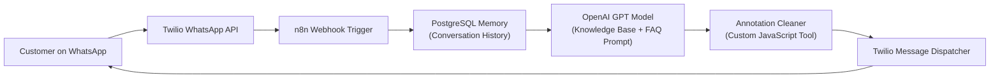

# WhatsApp AI Customer Support Agent – n8n, OpenAI & Twilio

<p align="center">
  <a href="https://github.com/codewithmuh/whatsapp-n8n/releases"></a>
  <a href="https://github.com/codewithmuh/whatsapp-n8n/stargazers"></a>
  <a href="https://github.com/codewithmuh/whatsapp-n8n/network/members"></a>
  <a href="LICENSE"></a>
  <a href="https://youtube.com/@codewithmuh"></a>
  <br>
  
  
  
  
</p>

This project sets up a production **WhatsApp AI Agent (Customer Support Assistant)** using **n8n**, **OpenAI**, **PostgreSQL**, and **Twilio**. The assistant automatically handles customer queries, provides responses based on logic and memory, and can escalate issues when needed.




## 🔧 Tech Stack

- [n8n](https://n8n.io): Workflow automation tool
- [Twilio](https://www.twilio.com/whatsapp): WhatsApp messaging API
- [OpenAI](https://platform.openai.com/): Natural language processing for intelligent responses

---

## 💡 Features

- Receives and reads incoming WhatsApp messages via Twilio
- Processes messages using OpenAI to generate context-aware replies
- Automatically removes irrelevant annotations (e.g., 【text】) using a custom JavaScript function
- Responds back via WhatsApp through Twilio
- Memory expressions for user identification and contextual conversations
- Logs message content with timestamps for tracking

---

## 🧠 Expressions & Logic

### 📩 User Message Capture

```handlebars
User Message:  {{ $json.data.body }}
```

### 📅 Current Timestamp

```handlebars
Today's date and the current time: {{ $now }}
```

### 📱 Phone Number (Memory Field)

```handlebars
{{ $('Twilio Trigger').item.json.data.from.replace('whatsapp:', '') }}
```

---

## 🧹 Code Tool: Annotation Cleaner

This function removes surrounding annotation blocks often found in AI-generated or formatted messages:

```javascript
function removeAnnotations(input) {
  return input.replace(/【[^】]*】/g, '').trim();
}

// Example usage
const output = removeAnnotations(query);
return output;
```

---

## 📤 Sending Reply via Twilio

**To:**

```handlebars
{{ $('Twilio Trigger').item.json.data.from.replace('whatsapp:', '') }}
```

**From:**

```handlebars
{{ $('Twilio Trigger').item.json.data.to.replace('whatsapp:', '') }}
```

Use these expressions in the `Twilio - Send an SMS` node to direct replies to the right user.

---

## 🚀 Getting Started

1. **Clone this repository**

2. **Configure Environment Variables** (Twilio SID, Auth Token, OpenAI API Key, etc.)

3. **Create a Workflow in n8n**
   - Set up a **Twilio Trigger** node to listen to incoming WhatsApp messages.
   - Add a **Code node** with the annotation removal logic.
   - Use the **OpenAI node** to generate a reply.
   - Send the response using **Twilio - Send an SMS** node.

4. **Deploy the Workflow**
   - You can use n8n Cloud or self-host using Docker.

---

## 📌 Notes

- Ensure your Twilio account is WhatsApp-enabled.
- Customize your OpenAI prompt to match your support tone (e.g., friendly, concise, professional).
- Memory expressions can be expanded to store chat history for better continuity.

---

## 🤝 Contributions

Feel free to open issues or submit PRs to improve functionality, edge case handling, or integrations!

---

## 📜 License

MIT License
